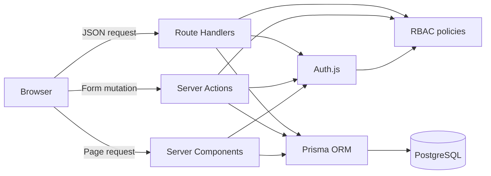

# TaskHarbor

A small task-management MVP built to demonstrate a production-shaped, full-stack Next.js application without a separate Express server.

TaskHarbor intentionally keeps the product scope narrow so the architecture remains easy to study: React Server Components render database-backed pages, Server Actions handle first-party form mutations, Route Handlers expose a JSON API, Auth.js manages credentials sessions, and Prisma connects the application to PostgreSQL.

## What this project demonstrates

- A single Next.js codebase serving the UI and backend
- Server Components for authenticated, database-backed reads
- Server Actions for internal form mutations
- Route Handlers for an external JSON interface
- Credentials authentication with JWT sessions and HTTP-only cookies
- Database-backed role-based access control (RBAC)
- PostgreSQL locally through Docker and in production through Neon
- Schema migrations and reproducible seed data with Prisma
- Automated quality checks with Vitest and GitHub Actions
- Git-based deployments to Vercel

## Core features

- Credentials sign-in and sign-out
- Eight-hour JWT sessions
- Admin and member roles
- Dashboard statistics scoped to the signed-in user
- Task search and status filtering through URL search parameters
- Create, assign, edit, update and delete task workflows
- Server-side Zod validation
- Responsive light and dark themes
- Loading, error, empty and not-found states
- Health and task JSON endpoints

## Authorization model

| Capability | Admin | Member |
| --- | :---: | :---: |
| View all workspace tasks | Yes | No |
| View assigned tasks | Yes | Yes |
| Create tasks | Yes | No |
| Edit task details and assignment | Yes | No |
| Update task status | Yes | Assigned tasks only |
| Delete tasks | Yes | No |

Authorization is enforced on the server. Hiding an unavailable button is only a user-interface decision; every Server Action and Route Handler authenticates the user and applies the relevant policy again.

## Architecture



### Request flow

1. `proxy.ts` performs an optimistic cookie-level redirect for protected pages.
2. The protected dashboard layout resolves the Auth.js session.
3. `getCurrentUser()` reloads the user from PostgreSQL, preventing a deleted or stale JWT user from being trusted.
4. Server-side queries apply role-aware Prisma filters. Members never receive unassigned task records from the database.
5. Mutations validate input, apply an authorization policy, write through Prisma and revalidate affected pages.

### Server Actions versus Route Handlers

TaskHarbor uses both deliberately:

- **Server Actions** power forms owned by this Next.js application. They provide progressive enhancement, typed server calls and UI refresh in one application flow.
- **Route Handlers** provide conventional HTTP endpoints for Postman, mobile clients or future integrations.

Both paths reuse the same Zod schemas, authentication helpers, RBAC policies, Prisma client and revalidation utility. The UI does not call its own Route Handlers from Server Components; server code queries PostgreSQL directly and avoids an unnecessary HTTP round trip.

## Next.js features used

- App Router and route groups
- React Server Components by default
- Client Components only for interactive forms, theme controls and pending states
- Server Actions with `useActionState` and `useFormStatus`
- Route Handlers using standard `Request` and `Response` APIs
- Async `params` and `searchParams`
- `Suspense`, streaming loading UI and Partial Prerendering
- Cache Components and `connection()` for request-time data
- `revalidatePath()` after mutations
- `loading.tsx`, `error.tsx` and `not-found.tsx`
- Metadata API and `next/font`
- Next.js proxy for optimistic route protection

## Technology stack

| Layer | Technology |
| --- | --- |
| Application | Next.js 16, React 19, TypeScript |
| Styling | Tailwind CSS 4, shadcn/ui source components, Base UI |
| Authentication | Auth.js 5 credentials provider, bcrypt |
| Validation | Zod |
| Database | PostgreSQL 17 |
| ORM | Prisma 7 with the PostgreSQL driver adapter |
| Local infrastructure | Docker Compose |
| Testing | Vitest |
| CI | GitHub Actions |
| Production | Vercel and Neon Postgres |

Redux or Zustand is intentionally not used. Server state stays on the server, filters live in the URL, form state stays local to the form, and the application does not yet have complex cross-page client state.

## Project structure

```text
src/
├── app/
│   ├── (auth)/login/                 # Public authentication page
│   ├── (dashboard)/                  # Protected application pages
│   │   ├── dashboard/
│   │   └── tasks/                    # List, create and edit routes
│   └── api/
│       ├── auth/[...nextauth]/       # Auth.js HTTP handlers
│       ├── health/                   # Database health endpoint
│       └── tasks/                    # Task collection and resource API
├── components/
│   ├── layout/                       # Application shell
│   └── ui/                           # Local shadcn-style primitives
├── features/
│   ├── auth/                         # Authentication, identity and RBAC
│   └── tasks/                        # Task UI, schemas, queries and actions
├── lib/                              # Prisma, API responses and utilities
├── auth.ts                           # Auth.js configuration
└── proxy.ts                          # Optimistic route protection

prisma/
├── migrations/                       # Versioned SQL migration history
├── schema.prisma                     # User, Task and enum models
└── seed.ts                           # Idempotent demo seed
```

Generated Prisma Client files live under `src/generated/prisma` and are excluded from Git. They are recreated during local setup, CI and production builds.

## Data model

The database contains two main models:

- `User`: name, unique email, bcrypt password hash and `ADMIN` or `MEMBER` role.
- `Task`: title, description, status, priority, due date, creator and optional assignee.

Foreign keys preserve ownership and assignment integrity. Indexed status, priority, creator, assignee and due-date columns support the current query patterns.

## Getting started locally

### Requirements

- Node.js 24+
- npm 11+
- Docker with Docker Compose

### 1. Clone and install

```bash
git clone https://github.com/Rajesh7rj/taskharbor.git
cd taskharbor
npm ci
```

### 2. Configure local environment

```bash
cp .env.example .env
openssl rand -base64 32
```

Replace `AUTH_SECRET` in `.env` with the generated value. The committed example connects to the Docker PostgreSQL service on port `5433`.

### 3. Start PostgreSQL

```bash
docker compose up -d
docker compose ps
```

### 4. Apply migrations and seed data

```bash
npm run prisma:generate
npm run db:migrate
npm run db:seed
```

Local demo accounts:

```text
Admin:  admin@taskharbor.dev
Member: aarav@taskharbor.dev
Member: maya@taskharbor.dev
Password: TaskHarbor123!
```

Set `SEED_USER_PASSWORD` only when a different seed password is required.

### 5. Start the application

```bash
npm run dev
```

Open [http://localhost:3000](http://localhost:3000).

Inspect local data with:

```bash
npm run db:studio
```

## API surface

The API uses the same Auth.js session cookie as the web application; it does not currently issue standalone Bearer tokens.

| Method | Endpoint | Access | Purpose |
| --- | --- | --- | --- |
| `GET` | `/api/health` | Public | Check application-to-database connectivity |
| `GET` | `/api/tasks` | Authenticated | List role-scoped tasks |
| `POST` | `/api/tasks` | Admin | Create a task |
| `GET` | `/api/tasks/:taskId` | Authorized user | Read one task |
| `PATCH` | `/api/tasks/:taskId` | Role-dependent | Edit details or update status |
| `DELETE` | `/api/tasks/:taskId` | Admin | Delete a task |

Supported list parameters:

```text
GET /api/tasks?query=release&status=IN_PROGRESS
```

The API returns consistent validation, authentication, authorization and not-found responses using HTTP `400`, `401`, `403` and `404` status codes.

## Scripts

| Command | Purpose |
| --- | --- |
| `npm run dev` | Start the development server |
| `npm run build` | Generate Prisma Client and build Next.js |
| `npm run start` | Start the production server locally |
| `npm run lint` | Run ESLint |
| `npm run typecheck` | Generate route/Prisma types and run TypeScript |
| `npm run test` | Run the Vitest suite once |
| `npm run check` | Run lint, typecheck, tests and production build |
| `npm run db:migrate` | Create/apply development migrations |
| `npm run db:deploy` | Apply committed migrations in production |
| `npm run db:seed` | Upsert demo users and tasks |
| `npm run db:studio` | Open Prisma Studio |

## Testing strategy

The project currently has 28 focused automated tests across six files:

- Zod task validation
- Pure RBAC policy decisions
- Health and task Route Handlers
- Server Action authorization and mutations

Authentication, Prisma and revalidation boundaries are mocked in unit/API tests, so the suite is deterministic and does not modify a real database.

```bash
npm run test
npm run check
```

Full browser E2E coverage is outside this MVP. The production admin and member flows are smoke-tested after deployment.

## CI/CD and deployment

### Continuous integration

GitHub Actions runs on pull requests and pushes to `main`:

```text
npm ci
  → Prisma Client generation
  → ESLint
  → TypeScript
  → 28 tests
  → production build
```

The workflow uses non-production placeholder environment values because protected pages access the database only at request time.

### Production deployment

- Vercel builds and deploys the Next.js application from GitHub.
- Neon hosts persistent PostgreSQL data independently of application deployments.
- `DATABASE_URL`, `AUTH_SECRET` and `AUTH_TRUST_HOST` are stored as encrypted Vercel environment variables.
- A production deployment does not recreate or reset PostgreSQL.

For a new committed Prisma migration:

```bash
read -s "NEON_DATABASE_URL?Paste Neon DATABASE_URL: "
DATABASE_URL="$NEON_DATABASE_URL" npm run db:deploy
unset NEON_DATABASE_URL
```

Application deployments and database migrations are intentionally separate operations. Migrations should be backward compatible when zero-downtime deployment matters.

## Security decisions

- Passwords are stored as bcrypt hashes, never plaintext.
- Session cookies are HTTP-only and backed by signed/encrypted Auth.js JWTs.
- JWT identity is revalidated against the database on protected server renders.
- Authorization is enforced in queries and mutations, not only in components.
- Member task lists are scoped in the Prisma `where` clause.
- Every mutation validates untrusted input with Zod.
- Secrets remain in ignored environment files or deployment settings.
- Production runtime dependencies currently report zero known npm audit vulnerabilities.

This remains an educational MVP. Before handling sensitive or high-volume workloads, add rate limiting, audit logs, password reset, email verification, account lifecycle controls, security headers review and browser-level E2E tests.

## MVP boundaries

TaskHarbor intentionally does not include:

- Public registration or password recovery
- OAuth providers
- Organizations or multi-tenant workspaces
- Comments, attachments or notifications
- Pagination or bulk operations
- Offline or optimistic updates
- Background jobs
- Standalone API access tokens

These omissions keep the project focused on the core full-stack Next.js request, authorization, database and deployment flow.
